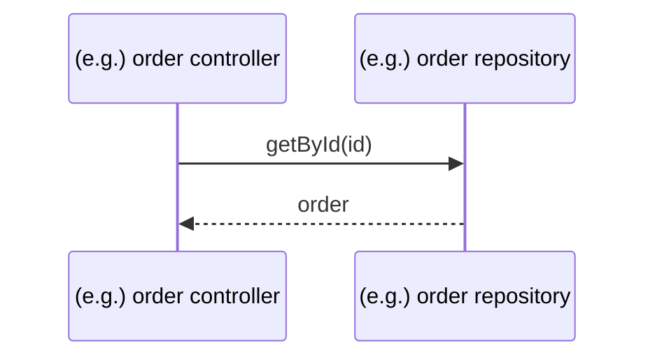
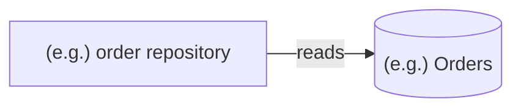

# Example Module — Flow (handover map)

> **Paired with `MODULE.md` — read that one FIRST.** It holds the rules and gotchas; this file holds the map. A new conversation needs BOTH.
>
> **Purpose: a handover document.** Orient anyone taking over this module (future-you or Claude).
> Captures how the module works NOW: its flow, the files/methods it calls, with short notes.
> **NOT a changelog** — change history lives in `impl/`, plans in `plans/`.
>
> Keep it current when the module's structure changes. You can seed/refresh it with
> `/wp-module-code-trace-flow`, but keep only the stable "how it works" parts — a specific change's
> "where to cut" belongs in that change's plan (`plans/`), not here.

## Diagram
(The main path, end to end — how a request / operation travels through this module — as a Mermaid
`sequenceDiagram`, drawn by `/wp-module-code-trace-flow` and kept in step with the table below by
`/wp-module-save-implementation`. After it, ≤3 lines: the reason and the caveats the diagram cannot
show. An optional interactive archify diagram is linked here as one line:
`Diagram: diagrams/<folder>/<file>.html — <type>, <date>`.)

## Data flow
(A Mermaid `flowchart LR` of the tables, views and files the module reads and writes, and which
method touches each. `None — no table access` when it has none.)

## Called files & methods
(`#` = the call's order on the main path; blank for a file that sits off the path.)

| # | File | Method | Role (short) |
|---|---|---|---|
| 1 | (e.g., any stack) order repository file | `getById` | reads one order from the DB |
| | | | |

## Shared symbols & their callers (fan-in)
(Symbols reused beyond the main path — base classes, shared constants/enums, reused result
objects, or anything a grep shows with more than one caller. The blast-radius map: who else
inherits an edit to this symbol. Filled by `/wp-module-code-trace-flow` Step 3.5.)

| Shared symbol | Callers (`file:method`) | Entry points |
|---|---|---|
| (e.g., any stack) base repository column builder | `orderRepo:insert`, `stockRepo:insert` | Web, Backend |
| | | |

## Notes
(Brief — only what genuinely helps someone pick this module up.)
